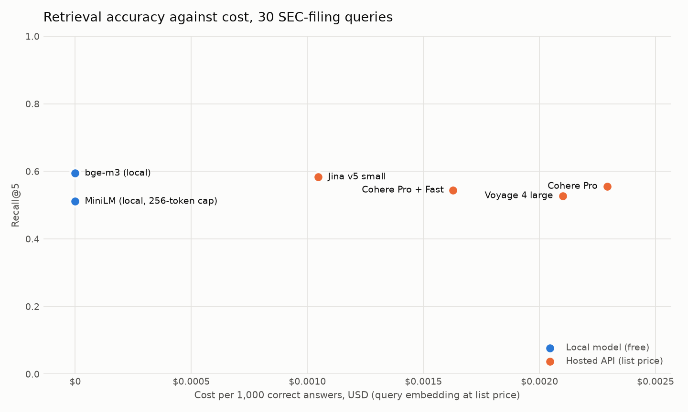

# embedding-bench

A small, reproducible comparison of embedding models for retrieving passages from SEC filings. Every setup gets the same chunks, the same queries and the same search code. Only the embedding model changes.

This is a demonstration of method on 30 queries, not a leaderboard. See [Limitations](#limitations).

## What was tested

| Setup | Model | How it ran |
|---|---|---|
| Local: bge-m3 | `BAAI/bge-m3` (8,192-token context) | sentence-transformers on a laptop CPU |
| Local: MiniLM | `sentence-transformers/all-MiniLM-L6-v2` | sentence-transformers on a laptop CPU. It reads only the first 256 tokens of each chunk, and most chunks are longer. |
| Cohere Pro | `embed-v5.0-pro` for chunks and queries | Cohere API, trial key |
| Cohere Pro + Fast | `embed-v5.0-pro` for chunks, `embed-v5.0-fast` for queries (Cohere's recommended setup) | Cohere API, trial key |
| Voyage | `voyage-4-large` | Voyage API, key with no payment method (3 requests/min, 10K tokens/min) |
| Jina | `jina-embeddings-v5-text-small` | Jina API, free key |

Model IDs, prices and rate limits are in [config/providers.yaml](config/providers.yaml), with the source for each and the date checked (2026-11-14).

**Data.** 985 chunks from 18 SEC EDGAR 10-K and 10-Q filings by Apple, Microsoft and NVIDIA (2025–2026), and 30 questions with hand-labelled relevant chunks. Both come from [FinSight](https://github.com/sansgitbug/Finsight), a RAG system over SEC filings. They are committed in [data/](data/) with SHA-256 hashes, and every run refuses to start if the files differ.

## Method

- **Search:** dense retrieval only. Exact cosine similarity over all 985 chunks, top 5. No approximate index, no keyword search, no reranker, no company filter.
- **Inputs:** each provider gets its documented document/query input type (`input_type` or `task`). No other prompt tuning.
- **Accuracy:**
  - **Recall@5**: share of a query's labelled chunks found in the top 5, averaged over the 30 queries.
  - **MRR@5**: 1/rank of the first labelled chunk in the top 5, 0 if none.
  - **Correct**: a query counts as correct if any labelled chunk is in its top 5.
- **Latency:** each query is embedded in its own call, sequentially, after one untimed warm-up call. p50 and p95 are over those 30 calls. API latency includes the network round trip from the test machine.
- **Indexing time:** time spent inside embedding calls for all chunks. It excludes time spent waiting to stay under rate limits, which is reported separately in [results/summary.md](results/summary.md).
- **Cost:** tokens reported by each provider × its list price, even though every run here used a free tier or trial key and cost nothing. **Cost per 1,000 correct** is query-embedding cost / correct × 1,000. The one-off indexing cost is in the total-cost column.
- **Raw results:** every query's top 5 chunk IDs with scores, latency and tokens are in `results/raw/<setup>.jsonl`.

## Results

| Setup | List price per 1M tokens | Recall@5 | MRR@5 | Correct (of 30) | Query p50 / p95 (ms) | Indexing time (s) | Total cost at list price | Cost per 1,000 correct |
|---|---:|---:|---:|---:|---:|---:|---:|---:|
| Local: bge-m3 | $0 | 0.594 | 0.530 | 22 | 158 / 199 | 2,637 | $0 | $0 |
| Jina v5 small | $0.05 | 0.583 | 0.581 | 21 | 299 / 318 | 47 | $0.0367 | $0.0010 |
| Cohere Pro | $0.12 | 0.556 | 0.462 | 20 | 355 / 363 | 34 | $0.0786 | $0.0023 |
| Cohere Pro + Fast | $0.12 index / $0.08 query | 0.544 | 0.518 | 20 | 347 / 361 | 34 | $0.0786 | $0.0016 |
| Voyage 4 large | $0.12 | 0.528 | 0.531 | 20 | 953 / 1,077 | 180 | $0.0877 | $0.0021 |
| Local: MiniLM (256-token cap) | $0 | 0.511 | 0.378 | 17 | 15 / 19 | 66 | $0 | $0 |

Full table, token counts and price sources: [results/summary.md](results/summary.md).



What the numbers show, and what they don't:

- **The top five setups are within 2 correct answers of each other** (22, 21, 20, 20, 20). One query is 3.3 percentage points, so these differences are not meaningful at this sample size.
- **MiniLM, which truncates chunks at 256 tokens, found the fewest.** It was also the fastest per query, by about 10×.
- **The free local model kept up with the APIs on accuracy but indexed slowly on CPU:** 44 minutes for bge-m3, against under a minute of call time for Cohere and Jina.
- **Cohere's recommended setup got the same 20 correct as Pro-only,** with a higher MRR and a lower query price.
- **At list price, indexing these 985 chunks cost under $0.09 with every API.** Query cost per 1,000 correct answers was a fraction of a cent everywhere.

## Reproduce

Copy `.env.example` to `.env` and add your Cohere, Voyage and Jina keys. Then:

```bash
pip install -r requirements.txt
python -m bench.run --all --yes
python -m bench.report
```

Embeddings are cached in `cache/`, which is not committed, so a fresh clone makes real API calls. On the free tiers above, that is about 260 Voyage calls (about 100 minutes, set by the 10K tokens/min limit), about 85 Cohere calls of a trial key's 1,000 per month, and about 730K Jina tokens.

Before spending anything:

- `python -m bench.run --estimate` shows calls and tokens still to spend.
- `python -m bench.run --provider <name> --dry-run` runs 3 queries against about 50 chunks.

The harness waits to stay under each provider's per-minute limits. It stops instead of retrying when a monthly call budget or token budget would be exceeded, and a stopped run resumes from cache. `python -m pytest` runs the tests.

To add a provider, write one file in [bench/providers/](bench/providers/) implementing `Provider.embed`, then add an entry to the config.

## Limitations

- **Small sample, one domain.** 30 queries on one domain: risk-factor-style questions about three large US tech companies' 10-K and 10-Q filings. This demonstrates a method; it is not evidence that one model is better than another in general. Differences of one or two queries are noise.
- **Thin labels.** 23 of 30 queries have exactly one labelled relevant chunk, labelled by one person. A model that finds a different but equally good passage is scored as a miss.
- **Near-duplicate passages.** Quarterly filings repeat text. For 2 of the 30 queries another filing contains a near-copy (8-word-shingle Jaccard > 0.8) of a labelled chunk, and retrieving it would be scored as a miss. In these runs, **0 misses in every setup** were near-duplicates, so this did not affect the numbers above. The check is in [data/near_duplicates.json](data/near_duplicates.json).
- **Latency comes from one machine on one home internet connection.** Compare providers relative to each other, not as absolute figures. Voyage ran on a reduced-limit key with no payment method; whether that tier is also slower per request was not tested. The local models ran on a laptop CPU, not a GPU.
- **Prices are list prices as of 2026-11-14.** Voyage's are from its pricing page and Jina's from its API dashboard ($50 for 1B tokens, the smallest paid pack). Cohere's come from its Embed 5 launch post, because its pricing page lists no per-token Embed price.
- **Rate limits.** Cohere's trial key enforced 100K tokens/min, which its rate-limits page does not list; it is stated in the API's own error messages. Voyage's limit for a key with no payment method (3 requests/min, 10K tokens/min) is likewise stated in its API's error messages, not its docs.
- **Default settings only.** Each model ran at its default output dimension: 2048 for Cohere, 1024 for Voyage, Jina and bge-m3, 384 for MiniLM. Smaller dimensions, quantisation and other options were not tested.
- **Results go stale.** Providers update models and prices; rerun before relying on these numbers.
