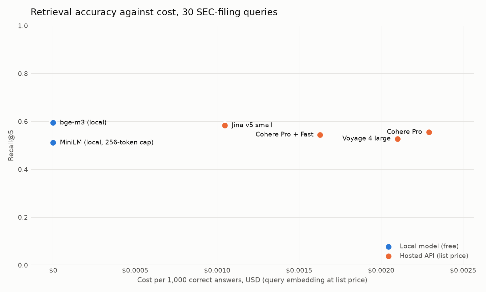

# Results

30 queries over 985 chunks, top 5 by exact cosine similarity. List prices were checked on 2026-11-14 (sources below). Costs are measured tokens times list price, not what was actually paid: the runs used free tiers and trial keys.

| Setup | List price per 1M tokens | Recall@5 | MRR@5 | Correct (of 30) | Query p50 (ms) | Query p95 (ms) | Indexing time (s) | Total cost at list price | Cost per 1,000 correct | Misses that were near-duplicates |
|---|---:|---:|---:|---:|---:|---:|---:|---:|---:|---:|
| Local: BAAI/bge-m3 (long context) | $0 | 0.594 | 0.530 | 22 | 158 | 199 | 2637 | $0 | $0 | 0 of 8 |
| Local: all-MiniLM-L6-v2 (truncates at 256 tokens) | $0 | 0.511 | 0.378 | 17 | 15 | 19 | 66 | $0 | $0 | 0 of 13 |
| Cohere: embed-v5.0-pro (index and query) | $0.12 | 0.556 | 0.462 | 20 | 355 | 363 | 34 | $0.0786 | $0.0023 | 0 of 10 |
| Cohere: embed-v5.0-pro index + embed-v5.0-fast query (Cohere's recommended setup) | $0.12 index / $0.08 query | 0.544 | 0.518 | 20 | 347 | 361 | 34 | $0.0786 | $0.0016 | 0 of 10 |
| Voyage: voyage-4-large | $0.12 | 0.528 | 0.531 | 20 | 953 | 1077 | 180 | $0.0877 | $0.0021 | 0 of 10 |
| Jina: jina-embeddings-v5-text-small | $0.05 | 0.583 | 0.581 | 21 | 299 | 318 | 47 | $0.0367 | $0.0010 | 0 of 9 |

How to read the columns:

- **Recall@5** is the share of a query's labelled passages found in the top 5, averaged over queries. **MRR@5** is 1/rank of the first labelled passage in the top 5 (0 if none), averaged over queries.
- **Correct** counts queries with at least one labelled passage in the top 5.
- **Query latency** is one embedding call per query, sent one at a time, after one untimed warm-up call. API latencies include the network round trip from the test machine; local latencies are model time on its CPU.
- **Indexing time** is time spent inside embedding calls for all chunks. It excludes time spent waiting to stay under rate limits, and batch sizes differ by provider (see the table below).
- **Total cost** is index tokens plus query tokens at list price. **Cost per 1,000 correct** uses query-embedding cost only: query cost / correct x 1,000.
- **Misses that were near-duplicates**: of the queries scored as misses, how many had a top-5 passage that is a near-copy (8-word-shingle Jaccard > 0.8) of a labelled passage from a different filing.

Where each list price came from:

- **Local: BAAI/bge-m3 (long context)**: free (open weights, MIT licence, run on the test machine)
- **Local: all-MiniLM-L6-v2 (truncates at 256 tokens)**: free (open weights, Apache-2.0 licence, run on the test machine)
- **Cohere: embed-v5.0-pro (index and query)**: Cohere Embed 5 launch post, 2026-09-30 (cohere.com/pricing lists no per-token Embed price)
- **Cohere: embed-v5.0-pro index + embed-v5.0-fast query (Cohere's recommended setup)**: Cohere Embed 5 launch post, 2026-09-30 (cohere.com/pricing lists no per-token Embed price)
- **Voyage: voyage-4-large**: docs.voyageai.com/docs/pricing
- **Jina: jina-embeddings-v5-text-small**: Jina API dashboard top-up page: $50 for 1B tokens, listed as 0.050 / 1M tokens (smallest paid pack)

| Setup | Dimensions | Index tokens | Query tokens | Index calls | Rate-limit wait while indexing (s) | Device |
|---|---:|---:|---:|---:|---:|---|
| Local: BAAI/bge-m3 (long context) | 1024 | 720,280 | 544 | 122 | 0 | cpu |
| Local: all-MiniLM-L6-v2 (truncates at 256 tokens) | 384 | 238,933 | 485 | 31 | 0 | cpu |
| Cohere: embed-v5.0-pro (index and query) | 2048 | 654,358 | 382 | 17 | 393 | provider API |
| Cohere: embed-v5.0-pro index + embed-v5.0-fast query (Cohere's recommended setup) | 2048 | 654,358 | 407 | 17 | 393 | provider API |
| Voyage: voyage-4-large | 1024 | 730,327 | 350 | 209 | 5941 | provider API |
| Jina: jina-embeddings-v5-text-small | 1024 | 733,243 | 440 | 20 | 441 | provider API |

